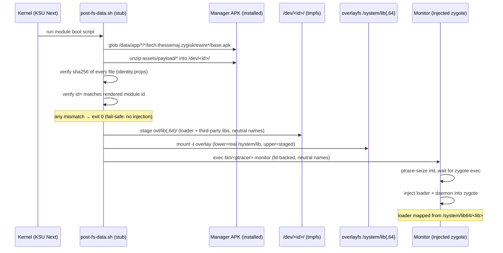
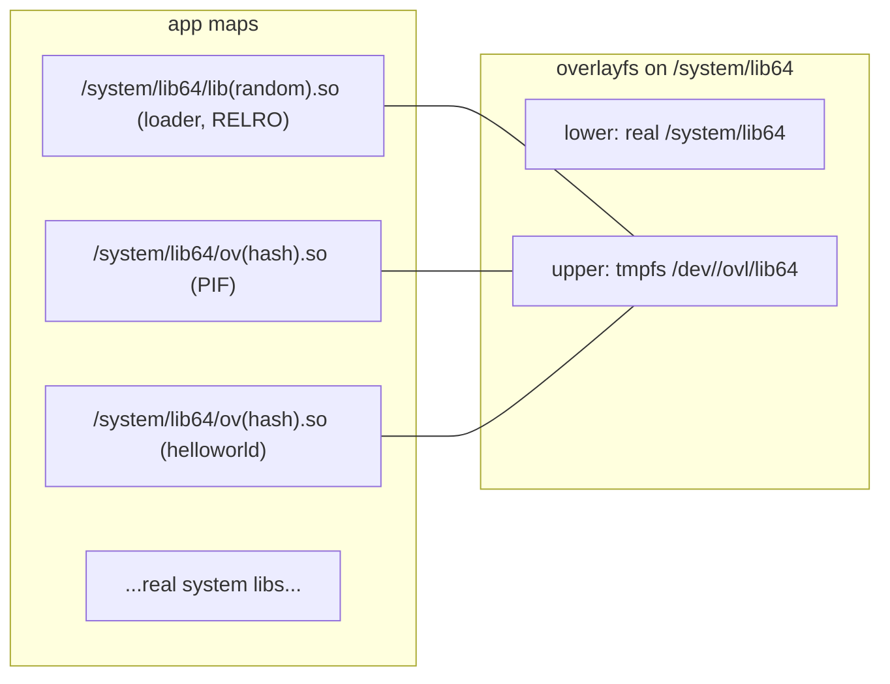

<div align="center">

```
██████╗ ███████╗██╗    ██╗██╗██████╗ ███████╗██████╗
██╔══██╗██╔════╝██║    ██║██║██╔══██╗██╔════╝██╔══██╗
██████╔╝█████╗  ██║ █╗ ██║██║██████╔╝█████╗  ██║  ██║
██╔══██╗██╔══╝  ██║███╗██║██║██╔══██╗██╔══╝  ██║  ██║
██║  ██║███████╗╚███╔███╔╝██║██║  ██║███████╗██████╔╝
╚═╝  ╚═╝╚══════╝ ╚══╝╚══╝ ╚═╝╚═╝  ╚═╝╚══════╝╚═════╝
```

### Zygisk, re-engineered for detection resistance. **Every build is someone else.**

[](LICENSE)
[](#-what-it-does)
[](#-per-build-identity)
[](#-how-a-boot-works)
[](#-the-system-library-mimic)
[](#-the-system-library-mimic)

[](https://github.com/iamjosephmj/ZygiskRewire/stargazers)
[](https://github.com/iamjosephmj/ZygiskRewire/network/members)
[](https://github.com/iamjosephmj/ZygiskRewire/issues)
[](https://github.com/iamjosephmj/ZygiskRewire/commits/main)
[](#)

**[What it does](#-what-it-does) · [Boot flow](#-how-a-boot-works) · [The mimic](#-the-system-library-mimic) · [Manager app](#-the-manager-app) · [Build](#%EF%B8%8F-build--install) · [Detector surface](#%EF%B8%8F-what-a-determined-detector-can-still-see)**

</div>

---

> [!IMPORTANT]
> ZygiskRewire is a stealth re-engineering of Zygisk: every build carries a
> fresh random identity, the runtime lives on tmpfs, the loader and all
> third-party module libraries present as system libraries, and the entire
> payload ships inside the manager app's APK. Nothing about one install —
> not a name, a path, a tag, or a string — matches the next.

---

<details>
<summary><b>Table of contents</b></summary>

- [🥷 What it does](#-what-it-does)
- [🎭 Per-build identity](#-per-build-identity)
- [🥾 How a boot works](#-how-a-boot-works)
- [🧬 The system-library mimic](#-the-system-library-mimic)
- [🕵️ Manager detection, without PackageManager](#%EF%B8%8F-manager-detection-without-packagemanager)
- [📟 The manager app](#-the-manager-app)
- [🧪 The validation module](#-the-validation-module)
- [🛠️ Build & install](#%EF%B8%8F-build--install)
- [⚠️ What a determined detector can still see](#%EF%B8%8F-what-a-determined-detector-can-still-see)
- [📚 Documentation](#-documentation)
- [🤝 Credits](#-credits)
- [📄 License](#-license)

</details>

---

## 🥷 What it does

Every build mints a fresh random identity — module id, daemon/ptracer binary
names, library names, socket names, SELinux type, log tags. Two builds share
nothing: an identifier, path, tag, or string from one install never matches
the next, so blocklists built from one install cannot fingerprint another.

The manager app (`tech.thessemaj.zygiskrewire`) carries the entire payload —
daemon, ptracer, and loader — in its APK assets. The boot stub locates the
installed APK, extracts the payload into a tmpfs runtime dir, verifies every
file's sha256 plus the module id against the build manifest, and refuses
silently on any mismatch (fail-safe: no injection, boot continues).

The module directory keeps only scripts, `module.prop`, `sepolicy.rule`, and
the webroot — no binaries ever persist under `/data/adb`.

```
flash zip → boot → find APK → sha256 gate → tmpfs → overlay /system/lib → ptrace init → inject zygote
```

## 🎭 Per-build identity

One run of `make identity` mints all of it — and none of it survives to the
next build:

| Layer | What gets randomized |
|:--|:--|
| Module | id (`syscfg-<8 hex>`), `module.prop`, webroot |
| Binaries | daemon, ptracer, and loader file names |
| IPC | daemon + controller socket names, state-file name |
| Kernel | SELinux type, log tags |
| Delivery | payload asset names + `identity.props` (id + per-file sha256) |

## 🥾 How a boot works



After injection, every app forked from the zygote carries the loader and the
module libraries — mapped file-backed from `/system/lib64/` paths, full RELRO,
no text relocations, exec text byte-identical to the overlay files.

## 🧬 The system-library mimic

Nothing in an app's memory maps points at `/data/adb`:



- The **loader** library is staged and mapped file-backed from the overlay:
  no text relocations (`-Wl,-z,text`), full RELRO (`BIND_NOW`, `GNU_RELRO`
  finalized read-only by the remote loader), exec text byte-identical to the
  overlay file.
- **Third-party module libraries** are staged at boot under neutral names
  (`ov` + 8 hex of sha256(module id), with a `.ovl` marker in the module's
  zygisk dir); ksud hands the loader the overlay path and the loader maps the
  library file-backed from `/system/lib64/<neutral>.so`. Modules without a
  marker fall back to their module-dir path.
- **Denylisted apps** have the overlay detached from their namespaces: no
  loader, no module libraries, no mount entries.

## 🕵️ Manager detection, without PackageManager

The daemon never asks PackageManager who the root manager is — PM is exactly
what hidden managers hide from. Instead it resolves the manager UID purely
root-side: statting `/data/user_de/<user>/<pkg>`, reading Magisk's own
`requester` database key for the repackaged app id, or asking the KernelSU
kernel for the manager UID directly. Manager detection keeps working while
the manager is invisible to PackageManager, and no binder PM call ever
appears on the wire. Full methodology in
[`docs/METHODOLOGY.md`](docs/METHODOLOGY.md).

## 📟 The manager app

The carrier app is the manager: a dark terminal HUD (three-page swipe —
status hero, injection pipeline, module cards) with root-backed status reads
and start/stop control over the tmpfs runtime. Root is requested only on
explicit user action; release builds are signed (local keystore with a
debug-signing fallback).

## 🧪 The validation module

`module-hello/` contains a complete third-party Zygisk module used to
validate the pipeline end to end: it loads in every app process, and shows an
animated **"CHECKS BYPASSED"** banner (red card, slide-down, glow pulse,
persistent until dismissed) in its two target detector apps — and nothing
anywhere else. It doubles as the starter template for writing modules against
ZygiskRewire.

## 🛠️ Build & install

```sh
make identity                  # mint this build's random identity
JAVA_HOME=<jbr> make release   # module zip + paired carrier APKs (auto)
./gradlew assembleDebug        # (alternative) carrier app only
```

> [!WARNING]
> The APK and zip must share one build identity — build them together with
> `make release`, never mix artifacts from different builds. And two
> ZygiskRewire modules cannot coexist on one device: uninstall the old module
> before flashing a new build.

1. Flash `build/out/SysConfig-*.zip` via your manager.
2. Install the paired APK from `app/build/outputs/apk/`.
3. Reboot.

## ⚠️ What a determined detector can still see

Stealth is engineering, not magic. The residual surface is accepted,
recorded, and tracked in [`docs/METHODOLOGY.md`](docs/METHODOLOGY.md):

| Detector probe | What it sees |
|:--|:--|
| `TracerPid` of init | the ptrace-on-init architecture itself |
| `dl_iterate_phdr` | nothing — the loader is invisible to the solist (by design, see phase-3 spike) |
| Unknown-system-lib heuristic | opaque names; the mapping is dictionary-invertible |
| `/proc/mounts` | the overlay entry, whose upperdir leaks the runtime dir name |
| Package visibility | the carrier app's package name and the (hidden) manager |

## 📚 Documentation

- [`docs/METHODOLOGY.md`](docs/METHODOLOGY.md) — the full stealth
  architecture: per-build identity, APK payload delivery, tmpfs runtime,
  system-library mimic, denylist interaction, manager identification, and
  the recorded residual surface.
- [`docs/superpowers/`](docs/superpowers/) — phase specs, plans, and
  research notes from the re-engineering effort.

## 🤝 Credits

- Fork of [PerformanC/ReZygisk](https://github.com/PerformanC/ReZygisk) —
  the Zygisk implementation this project re-engineers. GPL-3.0, upstream
  authors and license credited and preserved.
- Upstream channels:
  [PerformanC Discord](https://discord.gg/uPveNfTuCJ) ·
  [ReZygisk Telegram](https://t.me/rezygisk) ·
  [@performancorg](https://t.me/performancorg) on Telegram.

## 📄 License

GPL-3.0 — inherited from upstream ReZygisk; see [LICENSE](./LICENSE).
