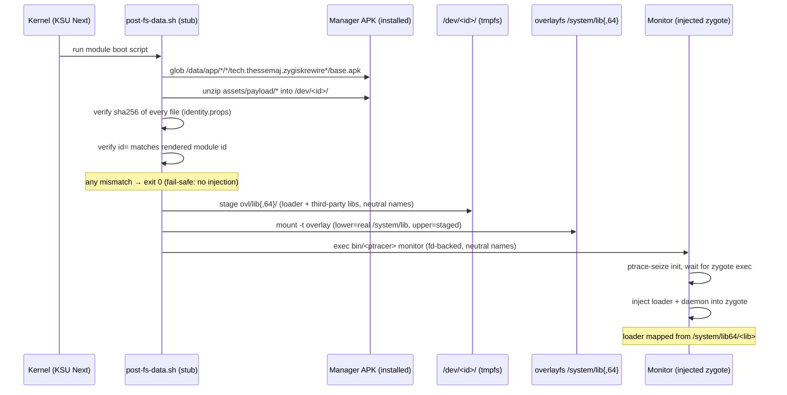
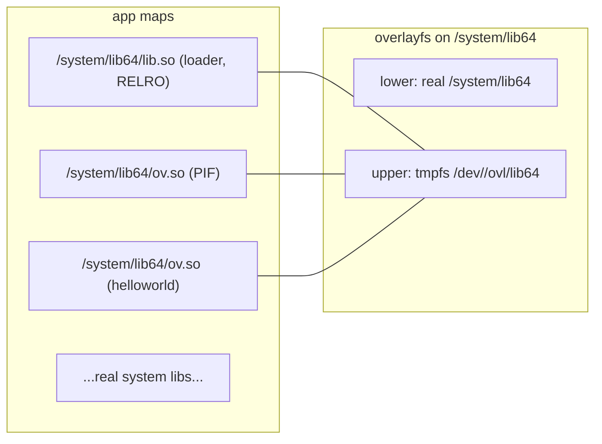

# ZygiskRewire

A stealth re-engineering of Zygisk: every build carries a fresh random
identity, the runtime lives on tmpfs, the loader and all third-party module
libraries present as system libraries, and the entire payload ships inside the
manager app's APK.

> **Credits** — ZygiskRewire is a fork of
> [PerformanC/ReZygisk](https://github.com/PerformanC/ReZygisk) (GPL-3.0;
> upstream, its authors, and its license are credited and preserved). Upstream
> channels: [PerformanC Discord](https://discord.gg/uPveNfTuCJ),
> [ReZygisk Telegram](https://t.me/rezygisk),
> [@performancorg](https://t.me/performancorg) on Telegram.

## What it does

Every build mints a fresh random identity — module id, daemon/ptracer binary
names, library names, socket names, SELinux type, log tags. Two builds share
nothing: an identifier, path, tag, or string from one install never matches
the next, so blocklists built from one install cannot fingerprint another.

The manager app (`tech.thessemaj.zygiskrewire`) carries the entire payload —
daemon, ptracer, and loader — in its APK assets. The boot stub locates the
installed APK, extracts the payload into a tmpfs runtime dir, verifies every
file's sha256 plus the module id against the build manifest, and refuses
silently on any mismatch (fail-safe: no injection, boot continues).

The module directory keeps only scripts, `module.prop`, `sepolicy.rule`, and
the webroot — no binaries ever persist under `/data/adb`.

## How a boot works



After injection, every app forked from the zygote carries the loader and the
module libraries — mapped file-backed from `/system/lib64/` paths, full RELRO,
no text relocations, exec text byte-identical to the overlay files.

## The system-library mimic

Nothing in an app's memory maps points at `/data/adb`:



- The **loader** library is staged and mapped file-backed from the overlay:
  no text relocations (`-Wl,-z,text`), full RELRO (`BIND_NOW`, `GNU_RELRO`
  finalized read-only by the remote loader), exec text byte-identical to the
  overlay file.
- **Third-party module libraries** are staged at boot under neutral names
  (`ov` + 8 hex of sha256(module id), with a `.ovl` marker in the module's
  zygisk dir); ksud hands the loader the overlay path and the loader maps the
  library file-backed from `/system/lib64/<neutral>.so`. Modules without a
  marker fall back to their module-dir path.
- **Denylisted apps** have the overlay detached from their namespaces: no
  loader, no module libraries, no mount entries.

## Manager app

The carrier app is the manager: a dark terminal HUD (three-page swipe —
status hero, injection pipeline, module cards) with root-backed status reads
and start/stop control over the tmpfs runtime. Root is requested only on
explicit user action; release builds are signed (local keystore with a
debug-signing fallback).

## The hello-world validation module

`module-hello/` contains a complete third-party Zygisk module used to
validate the pipeline end to end: it loads in every app process, and shows an
animated **"CHECKS BYPASSED"** banner (red card, slide-down, glow pulse,
persistent until dismissed) in its two target detector apps — and nothing
anywhere else. It doubles as the starter template for writing modules against
ZygiskRewire.

## Build & install

```sh
make identity                  # mint this build's random identity
JAVA_HOME=<jbr> make release   # module zip + paired carrier APKs (auto)
./gradlew assembleDebug        # (alternative) carrier app only
```

Install order matters — the APK and zip must share one build identity:

1. Flash `build/out/SysConfig-*.zip` via your manager.
2. Install the paired APK from `app/build/outputs/apk/`.
3. Reboot.

## Validation

Every phase lands only after: the identity gate (`scripts/check_identity.sh`)
PASS, per-task review waves with device evidence, a whole-branch adversarial
review, and a full on-device battery — single module, scripts-only module dir,
boot persistence, uninstall lifecycle with zero dangling overlays, stealth
greps (ps/unix/logcat), memory-maps headline with RELRO tiers, denylist
predicate live.

## Credits

- Fork of [PerformanC/ReZygisk](https://github.com/PerformanC/ReZygisk) —
  the Zygisk implementation this project re-engineers. GPL-3.0, upstream
  authors and license credited and preserved.
- Upstream channels:
  [PerformanC Discord](https://discord.gg/uPveNfTuCJ) ·
  [ReZygisk Telegram](https://t.me/rezygisk) ·
  [@performancorg](https://t.me/performancorg) on Telegram.

## License

GPL-3.0 — inherited from upstream ReZygisk; see [LICENSE](./LICENSE).
